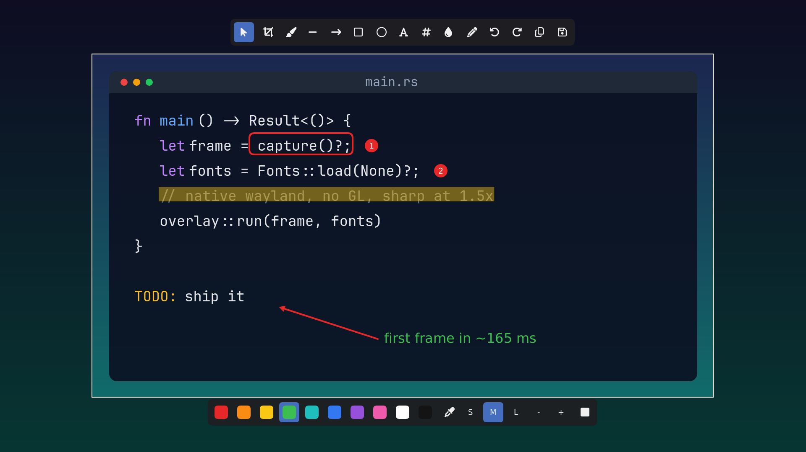
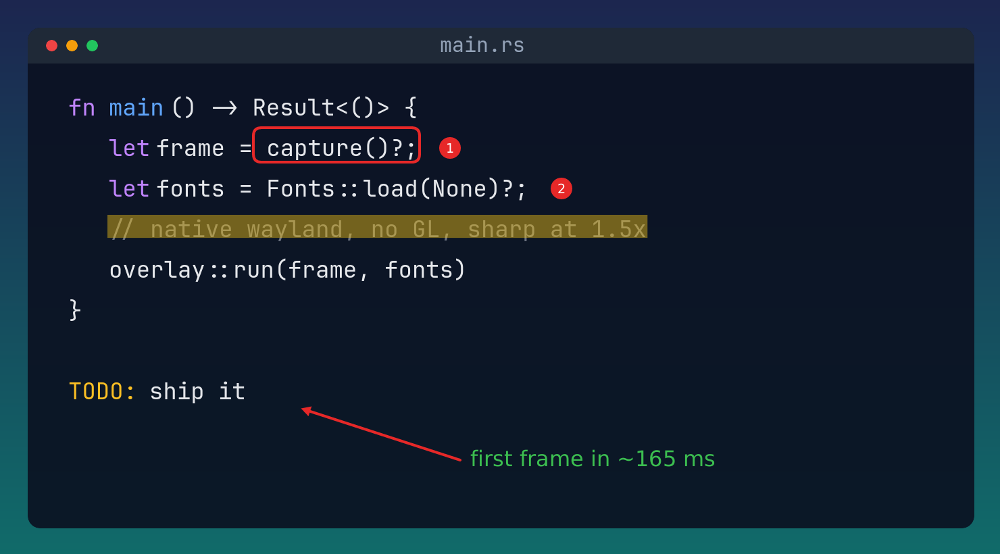

# shotr

A fast screenshot annotator for Hyprland. Freeze the screen, select a region and draw on it, all in one overlay.



shotr started as a replacement for `hyprshot | satty`. On a laptop with Intel + NVIDIA graphics, GTK4 can't get an OpenGL context on Wayland, so satty's canvas was black. shotr doesn't use GL at all: it draws on the CPU with tiny-skia and talks to the compositor directly through layer-shell.

## Why

|                        | hyprshot + satty | shotr        |
| ---------------------- | ---------------- | ------------ |
| Screen to first frame  | ~1680 ms         | **~190 ms**  |
| Rendering              | GTK4 + OpenGL    | CPU, no GL   |
| Fractional scaling     | depends on GTK   | pixel-sharp  |
| Select and annotate    | two programs     | one overlay  |

Median of 5 runs on an i5 laptop (Alder Lake, 1920x1080 at 1.5x). Most of the gain comes from skipping PNG compression on the capture and from not starting a toolkit.

## Result

What ends up in the clipboard: the crop at full resolution, with the annotations.



## Features

- Tools: pointer, crop, brush, line, arrow, rectangle, ellipse, text, numbered marker, blur, highlight
- Shift snaps lines to 15° and makes squares/circles, Alt draws from the center
- Undo/redo, zoom and pan, palette with custom colors, fill toggle, size factor
- Copy to the clipboard, save, save as, copy the saved path
- Text input with IME support and font fallback
- Reads satty's command line and config file, so it works as a drop-in replacement

## Install

Needs Rust, `grim`, `wl-clipboard` and `fontconfig`. `zenity` is used for the color picker and the save dialog.

```sh
cargo install --path .
```

## Usage

```sh
shotr                        # capture the focused monitor
shotr -f image.png           # annotate an existing image
grim -g "$(slurp)" - | shotr -f -
```

Hyprland binds:

```
bind = , Print, exec, ~/.cargo/bin/shotr
```

### Keys

| Key | Action |
| --- | --- |
| `p` `c` `b` `i` `z` | pointer, crop, brush, line, arrow |
| `r` `e` `t` `m` `u` `g` | rectangle, ellipse, text, marker, blur, highlight |
| `1`..`0` | palette colors |
| `Enter` | copy |
| `Ctrl+C` / `Ctrl+S` / `Ctrl+Shift+S` | copy / save / save as |
| `Ctrl+Alt+C` | copy the saved file path |
| `Ctrl+Z` / `Ctrl+Y` | undo / redo |
| `Ctrl+T` | toggle toolbars |
| `Delete` | remove the selected shape, or everything |
| `Ctrl+Wheel`, middle drag | zoom, pan |
| `Esc` | exit |

## Configuration

`~/.config/shotr/config.toml`, same format as satty's:

```toml
[general]
output-filename = "~/Pictures/Screenshots/shot-%Y%m%d-%H%M%S.png"
early-exit = ["copy"]
initial-tool = "arrow"
corner-roundness = 12

[keybinds]
blur = "x"

[font]
family = "Inter"
fallback = ["Noto Sans CJK SC"]

[color-palette]
palette = ["#e62828", "#fa8c14", "#3cbe50", "#2f80ed"]
```

Every option is also a flag, see `shotr --help`.

## License

MIT
